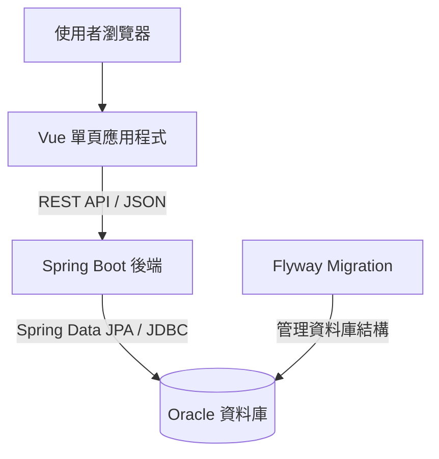

# OnlineBankingSystem 系統簡介

## 一、系統概述

OnlineBankingSystem 是採用前後端分離架構的網路銀行系統，提供使用者註冊、登入、銀行帳戶管理、存款、提款、轉帳、交易紀錄查詢及個人資料維護等功能。

本專案以既有 `onlinebanking` 系統的畫面、資料模型與商業流程為基準，將原有 JSF、Spring Web Flow 與 Spring 4 架構，重新實作為 Vue 前端與 Spring Boot REST API 後端。開發重點是維持既有功能與操作行為，並建立可獨立建置、啟動及維護的專案結構。

## 二、主要功能

| 功能 | 說明 |
| --- | --- |
| 使用者註冊 | 建立使用者資料、檢查使用者名稱是否可用；註冊成功後自動登入。 |
| 登入與登出 | 驗證使用者名稱與密碼，以伺服器 Session 維持登入狀態，並提供登出功能。 |
| 帳戶總覽 | 顯示目前使用者的帳戶清單、帳戶類型與餘額。 |
| 建立銀行帳戶 | 支援 Checking 與 Saving 帳戶，設定帳戶安全 PIN，新帳戶初始餘額為零。 |
| 存款 | 選擇自己的帳戶，驗證安全 PIN 後增加餘額並記錄交易。 |
| 提款 | 驗證帳戶歸屬、安全 PIN 與可用餘額，完成扣款並記錄交易。 |
| 帳戶轉帳 | 從自己的帳戶轉出至存在的目標帳戶，檢查安全 PIN、餘額及來源與目標是否相同，再更新雙方餘額並記錄交易。 |
| 交易紀錄查詢 | 依自己的帳戶與起訖日期查詢相關交易紀錄。 |
| 個人資料維護 | 查閱及修改姓名、性別、生日、地址、郵遞區號、電話與電子郵件。 |

## 三、操作流程

1. 使用者進入系統，註冊新帳號或登入既有帳號。
2. 登入後進入帳戶首頁，查看個人帳戶與餘額。
3. 建立銀行帳戶並設定安全 PIN。
4. 選擇存款、提款或轉帳，輸入必要資料與安全 PIN。
5. 完成交易後查看結果，或透過日期區間查詢交易紀錄。
6. 依需要更新個人資料，操作結束後登出。

## 四、系統架構



前端負責畫面呈現、表單操作、頁面路由及登入狀態管理；後端負責身分驗證、輸入驗證、帳戶歸屬檢查、餘額計算與交易處理。資料透過 Spring Data JPA 與 Oracle JDBC 存取，由 Flyway 管理資料庫結構版本。

存款、提款與轉帳透過後端交易管理，將餘額更新與交易紀錄寫入置於同一個資料庫交易範圍。金額計算使用 Java `BigDecimal`。

## 五、技術組成

| 層級 | 採用技術 | 用途 |
| --- | --- | --- |
| 前端介面 | Vue 3、TypeScript | 建立頁面、表單與互動元件。 |
| 路由與狀態 | Vue Router、Pinia | 管理頁面切換、登入狀態與存取導向。 |
| 前端建置 | Vite、npm | 提供開發伺服器、型別檢查與正式版本建置。 |
| 後端服務 | Java 21、Spring Boot 4.1.0、Spring MVC | 提供 REST API，包裝為可執行 Jar。 |
| 驗證機制 | Spring Security、Jakarta Validation、BCrypt | 處理登入驗證、輸入檢核及密碼與帳戶 PIN 雜湊。 |
| 資料存取 | Spring Data JPA、Oracle JDBC | 管理實體關聯、資料查詢與寫入。 |
| 資料庫 | Oracle | 儲存使用者、帳戶與交易資料。 |
| 結構版本管理 | Flyway | 依序建立與管理資料庫結構。 |
| 本機環境 | Docker Compose | 管理 Oracle、後端服務與獨立資料 volume。 |
| 後端建置 | Maven Wrapper | 編譯、執行測試與產生應用程式 Jar。 |

## 六、資料模型

| 資料表／物件 | 用途 |
| --- | --- |
| `BANK_USER` | 儲存使用者登入資料、基本資料與聯絡資訊。 |
| `ACCOUNT` | 儲存銀行帳戶類型、餘額、安全 PIN 雜湊與所屬使用者。 |
| `TRANSACTION_REC` | 儲存交易類型、金額、時間，以及來源與目標帳戶關聯。 |
| `HIBERNATE_SEQUENCE` | 提供實體識別碼所需的 Oracle sequence。 |
| `flyway_schema_history` | 記錄已執行的資料庫 migration 版本。 |

一位使用者可建立多個銀行帳戶；帳戶透過交易紀錄保存資金操作歷程。新環境使用獨立的 `ONLINEBANKINGSYSTEM` schema，migration 只建立所需結構，不匯入舊系統資料。

## 七、專案結構

```text
OnlineBankingSystem/
├── frontend/      Vue 前端、API 呼叫、路由、狀態與圖片資源
├── backend/       Spring Boot REST API、商業邏輯與測試
├── database/      資料庫結構參考與 migration 導覽
├── infra/         Docker Compose 與環境變數範例
├── docs/          各功能 Migration 與新舊系統比對文件
├── README.md      系統簡介
├── 規劃文件.md     專案規劃、建置與啟動說明
├── 專案Migration.md
└── 專案編譯與歷程.md
```

後端依功能分為 `auth`、`user`、`account`、`transaction`、`config` 與 `common` 模組，Java 基礎 package 為 `com.OnlineBankingSystem`。

## 八、本機環境

| 項目 | 預設設定 |
| --- | --- |
| 前端開發伺服器 | Vite 預設使用 `5173`；實際位址以啟動輸出為準。 |
| 後端服務 | Docker Compose 對外使用 `18080`。 |
| Oracle | Docker Compose 對外使用 `11521`。 |
| Oracle schema | `ONLINEBANKINGSYSTEM`。 |
| Oracle volume | `onlinebankingsystem_oracle_data`。 |

前端開發環境將 `/api` 請求代理至後端。Docker Compose 的對外連接埠與 volume 名稱可透過環境變數調整；本機密碼由未納入版本控制的環境檔提供。建置與啟動步驟請參閱 [規劃文件.md](規劃文件.md)。

## 九、目前範圍與延伸方向

目前程式已涵蓋註冊、登入、登出、帳戶建立與查詢、存提款、轉帳、交易紀錄及個人資料維護，並保留既有系統的主要畫面風格與操作流程。系統以既有功能移轉與行為一致為主要範圍。

後續可依需求擴充認證防護、交易併發控制、稽核機制及自動化整合測試；這些項目屬後續規劃，並非本簡介宣稱已完成的功能。

## 十、相關文件

- [專案規劃與啟動方式](規劃文件.md)
- [Migration 決策與開發規範](專案Migration.md)
- [各功能 Migration 文件](docs/README.md)
- [專案編譯與操作歷程](專案編譯與歷程.md)
